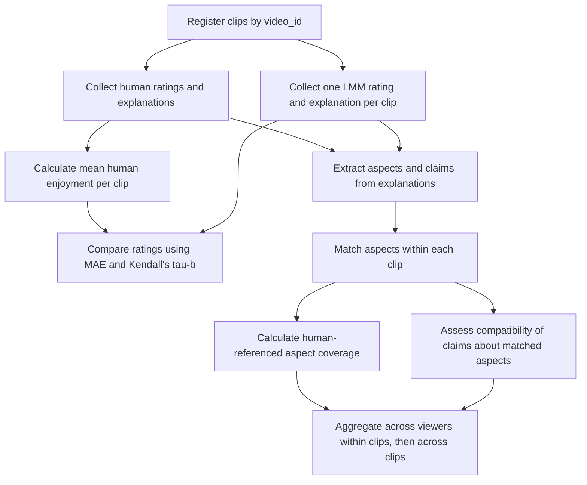

# Evaluating Agreement Between Automated Metrics and Human Enjoyment of AI-Generated Drama Clips

## 1. Research questions

**RQ1.** How strongly are scores on selected VBench and VBench-2.0 dimensions associated with viewer enjoyment of AI-generated drama clips? The class study compares each metric’s ranking with the ranking by mean human enjoyment. [RQ1 summary](rq1_summary.md)

**RQ2.** How closely do video-capable large multimodal model (LMM) judges align with viewers on enjoyment ratings and stated reasons? Rating alignment measures the similarity of scores and clip rankings. Reasoning alignment measures overlap in the aspects mentioned and compatibility of claims about those aspects.

## 2. Shared study design

The clip is the unit of analysis for rating comparisons. Aggregate valid human ratings to a clip mean, sample standard deviation, and rater count. Keep the individual ratings and explanations for human–human comparisons and analysis of stated reasons.

Clip-level inference assumes the clips are independent. If clips share a source drama, use one clip per source or account for clustering in the analysis. Record source provenance and check for repeated `source_id` values.

For RQ2, give viewers and the LMM the same clips, comparable audiovisual information, and a common 1–5 enjoyment scale. Use shared anchors such as 1 for “not enjoyable at all” and 5 for “extremely enjoyable.” Collect the LMM response without exposing human responses or VBench scores. Fix the evaluation rules and exclusions before examining associations. [RQ2 viewer prompt](../rq2_prompts/viewer.md)

## 3. RQ1 analysis

The completed class study scored 11 clips across seven dimensions. Twenty-nine viewers rated each of clips 01–10. The association notebook paired scores with average enjoyment by `video_id` and estimated Kendall’s tau-b for each testable dimension. The source IDs are distinct placeholders, so the analysis assumes the rated clips are independent. [RQ1 summary](rq1_summary.md) · [Results CSV](../rq1_outputs/rq1_kendall_results.csv)

Possible extensions include estimating conditional associations with an ordinal mixed-effects model that accounts for viewers and clips, or evaluating predictive performance on held-out clips.

## 4. RQ2 analysis plan

Collect one independent LMM response per clip and multiple human responses. Record both the enjoyment rating and the stated reasons for each response. The analysis uses the ratings to compare scores and rankings and the explanations to compare stated aspects and claims.

### Rating alignment

For $n$ clips, let $\bar{\mathbf y}\in\mathbb R^n$ contain mean human enjoyment and $\mathbf a\in\{1,2,3,4,5\}^n$ contain the LMM ratings. Align both vectors by `video_id`. The mean absolute error in rating points is

$$
\mathrm{MAE}=\frac{1}{n}\sum_{i=1}^n |a_i-\bar y_i|.
$$

Use $\tau_b(\mathbf a,\bar{\mathbf y})$ to measure rank agreement. Report the estimate, a clip-level 95% confidence interval, and a p-value. Compare the rating results with human–human variability and a simple baseline such as the mean rating from the training clips. [Kendall’s tau-b method](rq1_summary.md#kendalls-tau-b)

### Aspect extraction and coverage

Use a documented taxonomy for aspects such as narrative, dialogue, animation, humor, pacing, emotion, and audio. Map synonyms to the same aspect. Record how each aspect was described and whether its stated effect on enjoyment was positive, negative, mixed, or unspecified. Use the same coding rules for human and LMM explanations and validate a sample with human coders.

For one human and the LMM on the same clip, let $A_H$ and $A_L$ be their sets of distinct aspects. The fraction of human-mentioned aspects the LMM also mentions is

$$
\operatorname{Coverage}(A_H,A_L)=\frac{|A_H\cap A_L|}{|A_H|}.
$$

Coverage is zero when the human mentions aspects and none match. It is undefined when the human mentions no identifiable aspect. Count undefined comparisons. An optional companion measure uses $|A_L|$ as the denominator to measure the share of the LMM’s aspects that also appear in the human explanation.

### Claim compatibility

Compare claims about the same matched aspect. In natural language inference (NLI), use the human claim as the premise and the LMM claim as the hypothesis. Keep the label and score for entailment, contradiction, and neutrality. Entailment is directional. Use both directions or a predefined compatibility rubric when assessing mutual agreement.

Keep technical descriptions and stated effects on enjoyment distinct during coding. Validate a sample of the judgments, including cases with negation, sarcasm, irony, or mixed evaluations such as “bad but funny.” Report disagreements between the automated labels and human review.

For a human–LMM pair with $k$ matched claim pairs, let $q$ be the count judged compatible under the predefined rule. The agreement rate is

$$
\operatorname{Agreement}=\frac{q}{k}.
$$

Record agreement as undefined when $k=0$. Report contradiction and neutrality separately from agreement. [Reason-comparison prompt](../rq2_prompts/judge.md)

### Aggregation and interpretation

1. Record aspect coverage, claim agreement, and matched-claim count per human–LMM pair.
2. For each clip, average coverage and agreement over the respective defined pairs. Retain the human mean and standard deviation, LMM rating, absolute rating error, and undefined-pair counts.
3. At the study level, average the per-clip coverage and agreement values. Report these alongside MAE and Kendall’s tau-b, with clip-level intervals and sample sizes at each stage.

Use the clip as the resampling unit. Report human–human baselines for ratings, aspect coverage, and claim agreement where feasible. Low rating error with low coverage describes similar ratings with different aspects mentioned. High rating error with high coverage and agreement suggests the judge and viewers may weigh similar considerations differently. Claim comparisons address the reasons stated in the explanations. Cosine similarity of explanation embeddings and rescaled rating error can serve as supplementary measures.

Related work has evaluated LLM enjoyment estimates against human self-reports in human–robot dialogue. [Marcinek et al., SIGDIAL 2025](https://aclanthology.org/2025.sigdial-1.46/)

### Planned data files

| File | Unit | Key fields or measures |
| --- | --- | --- |
| `clips.csv` | Clip | `video_id`, source, duration, language, permissions |
| `human_evaluations.csv` | Viewer and clip | `video_id`, `human_id`, rating, explanation |
| `lmm_evaluations.csv` | LMM and clip | `video_id`, model version and settings, rating, explanation |
| `claims.csv` | Extracted claim | Evaluator, `video_id`, aspect, claim text, enjoyment effect |
| `pair_results.csv` | Human–LMM pair and clip | Coverage, agreement, matched-claim count, undefined flags |
| `video_summary.csv` | Clip | Human mean and SD, LMM rating, absolute error, mean coverage and agreement |
| `rq2_summary.json` | Study | MAE, Kendall’s tau-b, coverage, agreement, sample counts |

## 5. Reporting checklist

- Give clip and viewer counts, source sampling, scale anchors, and prompt text.
- Record metric and model versions, configurations, repository revisions, and the rationale for the selected dimensions or taxonomy.
- Report exclusions, missing values, undefined cases, estimates, intervals, and adjusted p-values where applicable.
- Describe the assumptions about independent clips and the viewer panel. For RQ2, also report coding and label validation and the human–human baselines.
