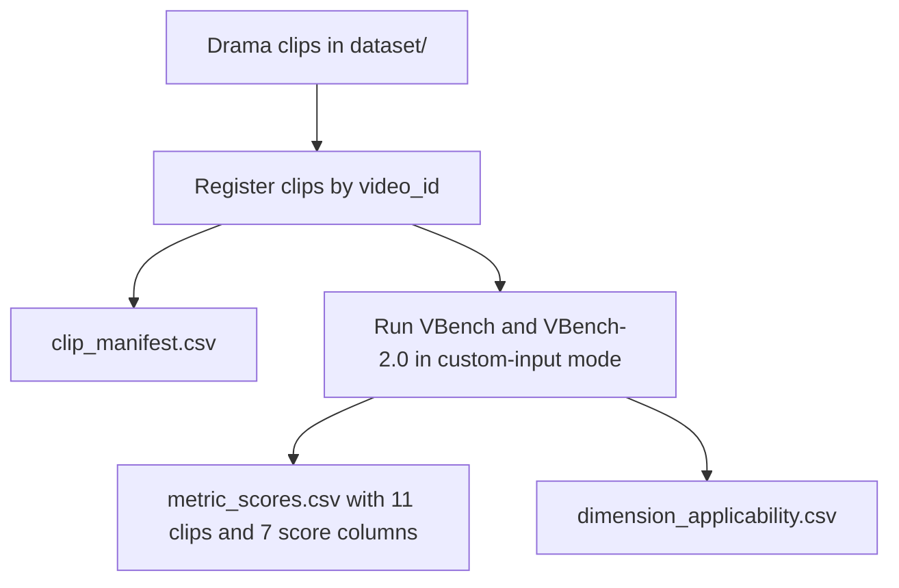
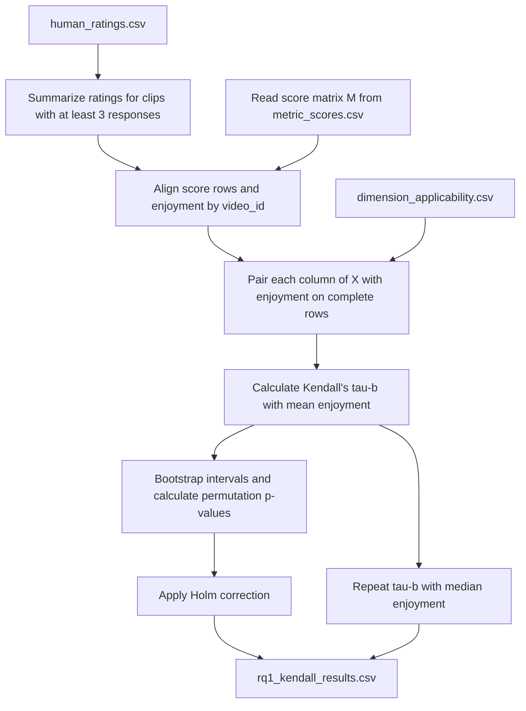

# RQ1 pipeline

RQ1 asks how strongly selected VBench and VBench-2.0 scores are associated with human enjoyment of AI-generated drama clips. The clip is the unit of analysis. Each metric score is paired with the average enjoyment rating for the same clip.

## 1. Register and score the clips

The scoring notebook reads the videos in `dataset/` and records each clip’s `video_id`, file path, duration, and `source_id` in the clip manifest. It runs the selected benchmark dimensions in custom-input mode and writes one row of scores per clip. Missing scores stay blank. [Scoring notebook](../notebooks/vbench_score_clips.ipynb) · [Clip manifest](../data/clip_manifest.csv) · [Metric scores CSV](../data/metric_scores.csv)

The applicability table marks seven dimensions as `scored`. Six come from VBench 1.0 (subject consistency, background consistency, motion smoothness, dynamic degree, aesthetic quality, and imaging quality). The seventh is VBench-2.0 human anatomy. Human identity and clothing require single-person clips. Diversity and multi-view consistency require sets of related videos. [Applicability table](../data/dimension_applicability.csv)

Write the score columns as a matrix $M=(M_{ij})$ with $N$ rows for scored clips and $d$ columns for metric dimensions. Use `video_id` as the row key and `source_id` as metadata. The study has $N=11$ and $d=7$, with a score in every cell, so $M\in\mathbb R^{11\times7}$.

The study’s scoring run used an **NVIDIA A100 with 80 GB of GPU memory and 170 GB of system RAM**. To score new clips, run the scoring notebook and extract `rq1_vbench_csvs.zip` into `data/`. Use the saved CSVs to rerun the association analysis for the current study.

## 2. Collect and aggregate viewer ratings

The anonymized survey file contains one row per viewer–clip pair, with `video_id`, `rater_id`, integer `enjoyment` from 1 to 5, and a `partial_watch` flag. The study retained all 290 ratings from 29 viewers, including 30 partial watches. Clips 01–10 each received 29 ratings. Clip 11 was excluded from the analysis because it received no survey ratings. [Anonymized survey CSV](../data/human_ratings.csv)

The association notebook validates the ratings, drops rows with missing enjoyment, and calculates mean enjoyment, median enjoyment, standard deviation, and rater count for each clip. It joins these summaries to the metric scores by `video_id` and keeps clips with at least three ratings. Let $X$ be the submatrix of $M$ for the $n$ eligible clips, ordered to match the rating summaries. Here $n=10$ and $X\in\mathbb R^{10\times7}$. [Association notebook](../notebooks/rq1-aidrama.ipynb)

For clip $i$, let $y_{iu}$ be rating $u$ and $r_i$ be the number of valid ratings. The clip-level mean $\bar y_i$, sample standard deviation $s_i$, and median $\tilde y_i$ are

$$
\begin{aligned}
\bar y_i &= \frac{1}{r_i}\sum_{u=1}^{r_i} y_{iu}, \\
s_i &= \sqrt{\frac{1}{r_i-1}\sum_{u=1}^{r_i}(y_{iu}-\bar y_i)^2}, \\
\tilde y_i &= \operatorname{median}(y_{i1},\ldots,y_{ir_i}).
\end{aligned}
$$

All $r=29$ viewers rated each eligible clip in this study, so the ratings form a matrix $Y=(y_{iu})\in\{1,2,3,4,5\}^{n\times r}$. The row-mean function yields the enjoyment vector $\bar{\mathbf y}\in\mathbb R^{10}$.

$$
A:\{1,2,3,4,5\}^{n\times r}\to\mathbb R^n,
\qquad
A(Y)=\frac{1}{r}Y\mathbf{1}_r=\bar{\mathbf y},
$$

where $\mathbf{1}_r$ is the length-$r$ vector of ones.

## 3. Estimate the associations

### Kendall’s tau-b

For dimension $j$, restrict column $X_{\cdot j}$ and the enjoyment vector $\bar{\mathbf y}$ to the same $n_j$ complete clip rows. Call the resulting vectors $\mathbf x_j$ and $\mathbf y_j$. Here $n_j=10$ for all seven dimensions. The notebook requires $n_j\ge4$ and variation in both vectors. On the subset $\mathcal D_{n_j}\subseteq\mathbb R^{n_j}\times\mathbb R^{n_j}$ satisfying those conditions, tau-b returns a single coefficient.

$$
\tau_b:\mathcal D_{n_j}\to[-1,1],
\qquad
\tau_{b,j}=\tau_b(\mathbf x_j,\mathbf y_j) =
\frac{P_j-Q_j}
{\sqrt{(P_j+Q_j+T_j)(P_j+Q_j+U_j)}}.
$$

$P_j$ and $Q_j$ count concordant and discordant clip pairs. $T_j$ counts pairs tied only on the metric score, and $U_j$ counts pairs tied only on mean enjoyment. Pairs tied on both are excluded from both counts. Positive tau-b means higher-scoring clips tended to have higher mean enjoyment. The sensitivity check computes $\tau_b(\mathbf x_j,\tilde{\mathbf y}_j)$, where $\tilde{\mathbf y}_j$ holds median enjoyment for those same clips.

### Bootstrap confidence interval

For each replicate $\ell$, draw $n_j$ row indices with replacement. Represent that draw by a selection matrix $S_\ell\in\{0,1\}^{n_j\times n_j}$ with one $1$ per row. Apply it to both vectors so the clip pairs stay together, then compute $\tau_b(S_\ell\mathbf x_j,S_\ell\mathbf y_j)$. Let $\mathcal B_j$ be the list of defined replicate estimates. The 95% percentile interval is

$$
\left[Q_{0.025}(\mathcal B_j),\ Q_{0.975}(\mathcal B_j)\right],
$$

where $Q_q$ is the quantile at probability $q$. The notebook attempts 2,000 replicates by default and requires at least 100 defined estimates to report the interval. A replicate with a constant metric or enjoyment column is undefined.

### Permutation test and Holm correction

Each shuffle maps $\mathbb R^{n_j}$ to $\mathbb R^{n_j}$ by applying a permutation matrix $\Pi$ to the enjoyment vector. Keep $\mathbf x_j$ fixed and compute $\tau_b(\mathbf x_j,\Pi\mathbf y_j)$. Let $E_j$ count permutations whose absolute tau-b is at least as large as the observed absolute tau-b. The test uses all $n_j!$ permutations when $n_j\le 7$ and uses $B=4{,}999$ Monte Carlo permutations by default for larger samples, including this study.

$$
p_{\mathrm{exact},j} = \frac{E_j}{n_j!},
\qquad
p_{\mathrm{MC},j} = \frac{1+E_j}{1+B}.
$$

The default random seed is 42. Holm correction maps $[0,1]^d$ to $[0,1]^d$, with one p-value for each of the $d=7$ scored dimensions. Use $p=1$ for an untestable dimension when forming the input vector. Sort its values as $p_{(1)} \le \cdots \le p_{(d)}$. The adjusted p-value for sorted rank $k$ is

$$
p^{\mathrm{Holm}}_{(k)} =
\min\left\{1,\ \max_{1\le \ell\le k} (d-\ell+1)p_{(\ell)}\right\}.
$$

Map the adjusted p-values back to the original metric order and compare each testable dimension’s value with $\alpha=0.05$. An untestable dimension has blank estimates and p-values in the output.

## 4. Report the study results

The association notebook writes one row per dimension, including sample sizes, missingness, estimates, intervals, p-values, and test status. None of the six testable dimensions reached statistical significance after Holm correction. Dynamic degree was constant at 1.0, and all 10 clips had a median enjoyment of 3, leaving the median sensitivity check undefined. [Results CSV](../rq1_outputs/rq1_kendall_results.csv) · [Findings](rq1_findings.md)

The study’s source IDs are placeholders. The analysis treats the 10 rated clips as independent, and the intervals reflect uncertainty across clips for the viewers who participated.
